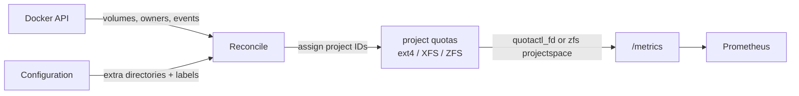

# DirAdvisor

Per-directory disk usage for Prometheus, without walking the file tree.

DirAdvisor runs as a container next to [cAdvisor](https://github.com/google/cadvisor) and
[node_exporter](https://github.com/prometheus/node_exporter). It reports how much space every Docker volume
and any configured directory uses, and which container and Compose stack owns it.

> **Status:** early development. Nothing is released yet.

## Why

- cAdvisor only reports a container's writable layer, not its volumes.
- node_exporter reports whole filesystems, not directories.
- Tools based on `du` have to touch every file on every run. On spinning disks with many small files that
  is slow and costly, so they can only run rarely.

DirAdvisor uses **project quotas** (ext4, XFS or ZFS) instead. The kernel keeps a running usage counter per directory
tree, so reading it costs one system call, no matter how many files the tree contains. Usage can be
scraped every minute, which makes growth alerts ("this volume grew by 2 GB in 30 minutes") practical.
No limits are set; quotas are used for accounting only.

## How it works

- **Discovery:** Docker volumes come from the Docker API, new ones are picked up from Docker events
  right away. Anything else, including bind-mounted directories, is added in a configuration file, with
  glob patterns and labels.
- **Ownership:** the container that mounts a volume read-write is its owner (`owner` is the container
  name, as in cAdvisor's `name` label). The owner's Compose project becomes the `stack` label.
  Assignments are remembered, so volumes of a stack that is shut down stay with that stack.
- **Project IDs:** DirAdvisor assigns and maintains the project IDs itself, including for new volumes.
- **Metrics:** usage is read from the kernel at scrape time.

## Requirements

- Linux **5.14 or newer** on `amd64` or `arm64` (the image is multi-arch).
- The measured directories on a filesystem with project quotas enabled. This is a one-time step for the
  admin; DirAdvisor never does it itself, it only sets project IDs:
  - **ext4:** `tune2fs -O project,quota <device>` on the unmounted filesystem;
  - **XFS:** mount with the `prjquota` option;
  - **ZFS** (OpenZFS 0.8+): `zpool set feature@project_quota=enabled <pool>`, and the ZFS tools
    installed on the host.

  When a step is missing, DirAdvisor reports it as `diradvisor_admin_action_needed` and logs the exact
  command.
- Docker. The container needs the capabilities `SYS_ADMIN` and `DAC_READ_SEARCH` (on ZFS hosts also
  the device `/dev/zfs`); `privileged` works as a fallback, like cAdvisor.

## Port

> **The default port changes with version 1.0.**
>
> Before 1.0, DirAdvisor serves `/metrics` on port **8080** (the same default as cAdvisor). With 1.0 the
> default changes to a port registered in the Prometheus
> [default port allocations](https://github.com/prometheus/prometheus/wiki/Default-port-allocations).
> If you depend on the port, set it explicitly with `--web.listen-address`, and update your Prometheus
> scrape configuration when you move to 1.0.

## Releases

Every merge into `master` that changes the image is a release (Semantic Versioning), published as
`ghcr.io/motwok/diradvisor:X.Y.Z` and `:latest`. **Updates of Go and of dependencies are released
automatically too**; read the risks and how to opt out in [RELEASING.md](RELEASING.md). Release notes
are on the [Releases page](https://github.com/motwok/DirAdvisor/releases), see also
[CHANGELOG.md](CHANGELOG.md).

## Contributing

Bug reports and feature requests go to **GitHub Issues**; **pull requests are welcome**.
See [CONTRIBUTING.md](CONTRIBUTING.md). Security problems are reported privately, see
[SECURITY.md](SECURITY.md). For help, see [SUPPORT.md](SUPPORT.md).

## License

[GNU Affero General Public License v3.0](LICENSE)

## Third-party

DirAdvisor is written in Go; its only dependency is the YAML parser go-yaml. See [NOTICE](NOTICE).

## Support Me

If you find this project useful, please consider supporting it
by buying me a coffee: [Buy Me a Coffee](https://ko-fi.com/motwok)
