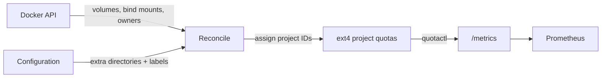

# DirAdvisor

Per-directory disk usage for Prometheus, without walking the file tree.

DirAdvisor runs as a container next to [cAdvisor](https://github.com/google/cadvisor) and
[node_exporter](https://github.com/prometheus/node_exporter). It reports how much space every Docker volume,
bind mount and any configured directory uses, and which container and Compose stack owns it.

> **Status:** early development. Nothing is released yet.

## Why

- cAdvisor only reports a container's writable layer, not its volumes.
- node_exporter reports whole filesystems, not directories.
- Tools based on `du` have to touch every file on every run. On spinning disks with many small files that
  is slow and costly, so they can only run rarely.

DirAdvisor uses **ext4 project quotas** instead. The kernel keeps a running usage counter per directory
tree, so reading it costs one system call, no matter how many files the tree contains. Usage can be
scraped every minute, which makes growth alerts ("this volume grew by 2 GB in 30 minutes") practical.
No limits are set; quotas are used for accounting only.

## How it works

- **Discovery:** volumes and bind mounts come from the Docker API. Extra directories come from a
  configuration file, with glob patterns and labels.
- **Ownership:** the container that mounts a volume read-write is its owner; read-only mounts are listed as
  readers. The owner's Compose project becomes the `stack` label. Assignments are remembered, so volumes of
  a stack that is shut down stay with that stack.
- **Project IDs:** DirAdvisor assigns and maintains the project IDs itself, including for new volumes.
- **Metrics:** usage is read from the kernel at scrape time.

## Requirements

- Linux with ext4. The filesystem must have the `project` and `quota` features enabled (one-time, see
  the documentation once it exists).
- Docker. The container runs privileged, like cAdvisor.

## License

[GNU Affero General Public License v3.0](LICENSE)
