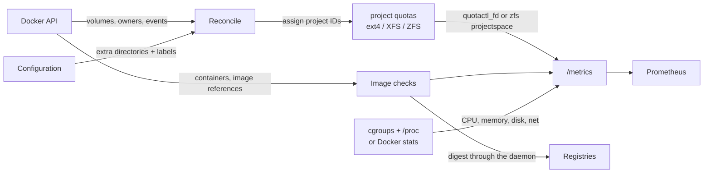

# HatchLens

[](https://github.com/motwok/HatchLens/actions/workflows/build.yml)
[](https://github.com/motwok/HatchLens/releases/latest)

[](go.mod)

[](LICENSE)
[](https://ko-fi.com/motwok)

Per-directory disk usage, image update checks and CPU, memory, disk and network usage of all
containers for Prometheus.

HatchLens runs as a container on Linux and Windows Docker hosts, or as a Windows service on the host,
next to the host exporter: [node_exporter](https://github.com/prometheus/node_exporter) on Linux,
[windows_exporter](https://github.com/prometheus-community/windows_exporter) on Windows. It reports how much space every Docker volume
and any configured directory uses, and which container and Compose stack owns it, without walking the
file tree. It also reports for every container whether its registry has a newer image than the one it
runs, and how much CPU, memory, disk I/O and network traffic it uses, per Docker network.

> **Status:** early releases (0.x). Behavior and metrics may still change before 1.0.

## Why

- cAdvisor reports only a container's writable layer, not its volumes, and does not run on Windows hosts.
  HatchLens replaces it: CPU, memory, disk and network per container on Linux and Windows alike.
- node_exporter and windows_exporter report whole filesystems, not directories.
- Tools based on `du` have to touch every file on every run. On spinning disks with many small files that
  is slow and costly, so they can only run rarely.

HatchLens uses **project quotas** (ext4, XFS or ZFS) instead. The kernel keeps a running usage counter per directory
tree, so reading it costs one system call, no matter how many files the tree contains. Usage can be
scraped every minute, which makes growth alerts ("this volume grew by 2 GB in 30 minutes") practical.
No limits are set; quotas are used for accounting only.

## How it works



On Windows the HatchLens Host service takes the place of the project quotas: it measures NTFS
directories from one walk plus the USN journal and maps the network traffic to Docker networks.

- **Discovery:** Docker volumes come from the Docker API, new ones are picked up from Docker events
  right away. Anything else, including bind-mounted directories, is added in a configuration file, with
  glob patterns and labels.
- **Ownership:** the container that mounts a volume read-write is its owner (`owner` is the container
  name). The owner's Compose project becomes the `stack` label.
  Assignments are remembered, so volumes of a stack that is shut down stay with that stack.
- **Project IDs:** HatchLens assigns and maintains the project IDs itself, including for new volumes.
- **Metrics:** usage is read from the kernel at scrape time.

## Image update checks

For every container whose image comes from a registry, HatchLens asks the registry through the Docker
daemon for the current digest of the reference the container was started with (`postgres:16-alpine`),
once per reference and `check_interval` (24h), spread over the interval. It reports whether an update
is available, since when, and whether the new image was already pulled but the container not recreated.
Nothing is pulled or restarted; the rollout stays with your deployment. Compose stacks and Swarm
services are supported; private registries get credentials in the config. Each check of a Docker Hub
image counts as one pull.

## Container usage

For every running container: CPU time, CPU and memory limits, memory use and working set, OOM kills,
bytes and operations read and written, and network traffic per interface, labelled with the Docker
network it belongs to. On Linux the counters come straight from the host's cgroups and `/proc` at scrape
time; no Docker stats requests, no extra capability. Values are per container, not per
process.

On Docker hosts with **Windows** containers (Windows Server 2022 and 2025) the same image tag runs the
image checks and the container usage (from the Docker stats API). With the small **HatchLens Host**
service installed on the host (an MSI of every release) it also measures Docker volumes and directories
and splits the traffic per Docker network; see [Install.md](docs/Install.md#windows). Or run HatchLens
itself as a Windows service on the host, everything in one process, from its own MSI.

## Requirements

- Linux **5.14 or newer** on `amd64` or `arm64` (the image is multi-arch).
- The measured directories on a filesystem with project quotas enabled. This is a one-time step for the
  admin; HatchLens never does it itself, it only sets project IDs:
  - **ext4:** `tune2fs -O project,quota <device>` on the unmounted filesystem;
  - **XFS:** mount with the `prjquota` option;
  - **ZFS** (OpenZFS 0.8+): `zpool set feature@project_quota=enabled <pool>`, and the ZFS tools
    installed on the host.

  When a step is missing, HatchLens reports it as `hatchlens_admin_action_needed` and logs the exact
  command.
- Docker. The container needs the capabilities `SYS_ADMIN` and `DAC_READ_SEARCH` (on ZFS hosts also
  the device `/dev/zfs`); `privileged` works as a fallback.
- **Windows:** Windows Server 2022 or 2025 with Docker and Windows containers. Volumes and directories
  on NTFS with a USN journal need the HatchLens Host service (MSI) or HatchLens itself as a service;
  see [Install.md](docs/Install.md#windows).

## Quick start

```yaml
services:
  hatchlens:
    image: ghcr.io/motwok/hatchlens:latest
    restart: unless-stopped
    cap_add: [ SYS_ADMIN, DAC_READ_SEARCH ]
    # devices: [ /dev/zfs ]          # only on ZFS hosts
    volumes:
      - /var/run/docker.sock:/var/run/docker.sock:ro
      - /:/host:rslave               # project IDs are set on host directories
      - hatchlens-data:/data        # state.json, images.json, config.yml if used
    ports:
      - "8080:8080"
volumes:
  hatchlens-data:
```

Docker volumes are measured and all containers checked without any config. Other directories go into the config: a file named in
`HATCHLENS_CONFIG_FILE` (e.g. `/data/config.yml`) or the YAML itself in `HATCHLENS_CONFIG`, read at start:

```yaml
directories:
  - path: /srv/backup
    labels: { stack: backup }
  - path: /home/*                    # every match is its own entry
    labels: { user: "$1" }
  - path: ${DATA_ROOT}/archive       # environment variables of the container
```

Main metrics: `hatchlens_directory_bytes` and `hatchlens_directory_inodes` (labels `path`, `source`,
`volume`, `stack`), `hatchlens_directory_info` (`owner`, `state`, `project_id`),
`hatchlens_admin_action_needed` and `hatchlens_directory_unmeasurable` (what is missing and why; the
log has the exact command); `hatchlens_container_image_update_available` (labels `container`, `image`,
`stack`), its `_since_timestamp_seconds` and `hatchlens_container_image_update_pulled`;
`hatchlens_container_cpu_usage_seconds_total`, `hatchlens_container_memory_working_set_bytes`,
`hatchlens_container_disk_*` and `hatchlens_container_network_*` (labels `container`, `stack`,
`network`). Endpoints:
`/metrics`, `/-/healthy`, `/-/ready`.

## Documentation

- [Install.md](docs/Install.md): enabling project quotas per filesystem, running the container on Linux
  and Windows, Prometheus, update, uninstall.
- [Configuration.md](docs/Configuration.md): config source and every key.
- [Metrics.md](docs/Metrics.md): all metrics, reasons and admin actions, example queries and alerts.
- [Troubleshooting.md](docs/Troubleshooting.md): what to do when something looks wrong.
- [Build.md](docs/Build.md): building, unit and integration tests, coverage.

## Port

> **The default port changes with version 1.0.**
>
> Before 1.0, HatchLens serves `/metrics` on port **8080**. With 1.0 the
> default changes to a port registered in the Prometheus
> [default port allocations](https://github.com/prometheus/prometheus/wiki/Default-port-allocations).
> If you depend on the port, set it explicitly with `listen_address`, and update your Prometheus
> scrape configuration when you move to 1.0.

## Releases

Every merge into `master` that changes the image is a release (Semantic Versioning), published as
`ghcr.io/motwok/hatchlens:X.Y.Z` and `:latest` (Linux amd64/arm64 and Windows in one tag), with
`hatchlens-host-X.Y.Z.msi` and `hatchlens-X.Y.Z.msi` attached to the release. **Updates of Go and of dependencies are released
automatically too**; read the risks and how to opt out in [RELEASING.md](RELEASING.md). Release notes
are on the [Releases page](https://github.com/motwok/HatchLens/releases), see also
[CHANGELOG.md](CHANGELOG.md).

## Contributing

Bug reports and feature requests go to **GitHub Issues**; **pull requests are welcome**.
See [CONTRIBUTING.md](CONTRIBUTING.md). Security problems are reported privately, see
[SECURITY.md](SECURITY.md). For help, see [SUPPORT.md](SUPPORT.md).

## License

[GNU Affero General Public License v3.0](LICENSE)

## Third-party

HatchLens is written in Go; its dependencies are the YAML parser go-yaml and, for Windows,
`golang.org/x/sys` and go-winio. See [NOTICE](NOTICE).

## Support Me

If you find this project useful, please consider supporting it
by buying me a coffee: [Buy Me a Coffee](https://ko-fi.com/motwok)
