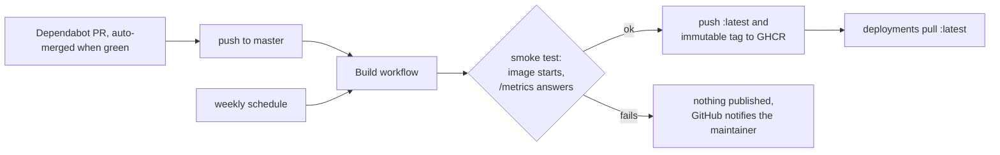

# Releasing DirAdvisor

DirAdvisor is released as a container image, `ghcr.io/motwok/diradvisor`. There is no manual release
step: every green build of `master` is a release. The workflows described here are being set up together
with the first code; until then nothing is published.

## Workflows at a glance

| Workflow | File | Trigger | What it does |
|---|---|---|---|
| **Build** | `build.yml` | PR to `master`, push to `master`, weekly schedule | Builds the image with `--pull` and without cache, runs the smoke test and, except for PRs, pushes `:latest` and an immutable tag to GHCR. |
| **Dependabot** | `.github/dependabot.yml` | Dependabot schedule | Opens PRs for the Go modules (`go.mod`), the `golang` build image in the `Dockerfile` and the GitHub Actions used; they are merged automatically once the build is green. |

## Release flow

1. A change is merged into `master` through a PR (feature branch, squash merge).
2. The Build workflow builds the image, always from a freshly pulled `golang` build image and without
   cache. The result is `FROM scratch` and contains only the static binary.
3. The **smoke test** starts the image and checks that `/metrics` answers. If it fails, nothing is
   published.
4. On success the image is pushed as `:latest` and as an immutable tag (build date plus short commit
   SHA) for rollback.

## Weekly rebuild

The schedule rebuilds the image **every week, even when nothing changed**. That picks up Go patch
releases (security fixes in the standard library) without a code change, and it keeps `diradvisor_build_timestamp_seconds`
honest: an old image always means that the build or the rollout is stuck, never "nothing changed". The
cost is one container restart per week.

## Rollback

Pin the deployment to the immutable tag of an earlier build instead of `:latest`, then switch back to
`:latest` once a fixed image is published.

## Deployment

DirAdvisor only publishes `:latest`. Pulling it and redeploying the container is up to the deployment,
for example a scheduled stack redeploy. No credentials are needed: the repository and the image are
public.
