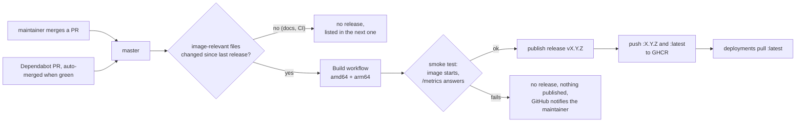

# Releasing DirAdvisor

DirAdvisor is released as a container image, `ghcr.io/motwok/diradvisor`, with
[Semantic Versioning](https://semver.org) (0.x before 1.0). **Every merge into `master` that changes the
image is a release**, that is changes to Go code, `go.mod`/`go.sum` or the `Dockerfile`. Merges that
only touch documentation or CI build nothing new; they are listed in the next real release. There is no
manual release step: merging a pull request is the approval.

## Workflows at a glance

| Workflow | File | Trigger | What it does |
|---|---|---|---|
| **Build** | `build.yml` | PR to `master`, push to `master` | Builds the image for `amd64` and `arm64` and runs the smoke test. On a push to `master` that changed the image it then publishes the release `vX.Y.Z` and pushes `:X.Y.Z` and `:latest` to GHCR. |
| **Release Drafter** | `release-drafter.yml` | PR events, push to `master` | Labels pull requests from their Conventional Commit titles and keeps the release notes of the next version up to date. |
| **Dependabot** | `.github/dependabot.yml` | Dependabot schedule | Opens PRs for the Go modules (`go.mod`), the `golang` build image in the `Dockerfile` and the GitHub Actions used; they are merged automatically once the build is green. |

## Release flow

1. A change is merged into `master` through a PR (feature branch, squash merge).
2. The Build workflow builds the image from the pinned `golang` build image, without cache. The result
   is `FROM scratch` and contains only the static binary.
3. The **smoke test** starts the image and checks that `/metrics` answers. If it fails, there is no
   release and nothing is published.
4. On success the release `vX.Y.Z` is published with notes generated from the merged pull requests, and
   the image is pushed as `:X.Y.Z` and `:latest`.

## Version numbers

The next version follows from the labels of the merged pull requests:

| Labels | Version step |
|---|---|
| `breaking`, `major` | major |
| `feature`, `enhancement` | minor |
| anything else (`fix`, `docs`, `chore`, `dependencies`, no label) | patch |

Labels are set automatically from Conventional Commit titles (`feat:`, `fix:`, `docs:`, ...).

## Dependency updates are released automatically

**An update of Go or of a dependency triggers a release on its own** (updates of GitHub Actions only
touch CI and do not). Dependabot opens the pull request,
it is merged automatically once the build and the smoke test pass, and the result is a new patch
release. If you run `:latest` and redeploy regularly, you get it without doing anything.

That is how security fixes in Go and its standard library reach you quickly. It also means:

> **Risk:** if a Go release or a dependency is itself vulnerable or compromised, that is shipped
> automatically as well, before anyone has looked at it.

What limits that risk:

- DirAdvisor has a single dependency besides the Go standard library (the YAML parser go-yaml).
- `go.sum` pins every module and is checked against the Go checksum database.
- Dependabot waits **3 days** after a new version appears before proposing it (cooldown), so a
  compromised release that is found and pulled quickly never reaches DirAdvisor. Security updates for
  known vulnerabilities are not delayed.
- The `golang` build image is pinned in the `Dockerfile` and only changes through a reviewed-by-CI pull
  request.
- No release without a green build and smoke test.

If you want to control updates yourself, **pin a version tag** (`:X.Y.Z`) instead of `:latest` and
update deliberately after reading the release notes.

## Rollback

Version tags are never rebuilt. Pin the deployment to the version tag of an earlier release instead of
`:latest`, then switch back to `:latest` once a fixed release is published.

## Deployment

DirAdvisor only publishes images. Pulling `:latest` and redeploying the container is up to the
deployment, for example a scheduled stack redeploy. No credentials are needed: the repository and the
image are public.

DirAdvisor can optionally tell you when a newer `:latest` exists than the one it runs (image update
check, off by default), so you notice a stuck redeploy.
